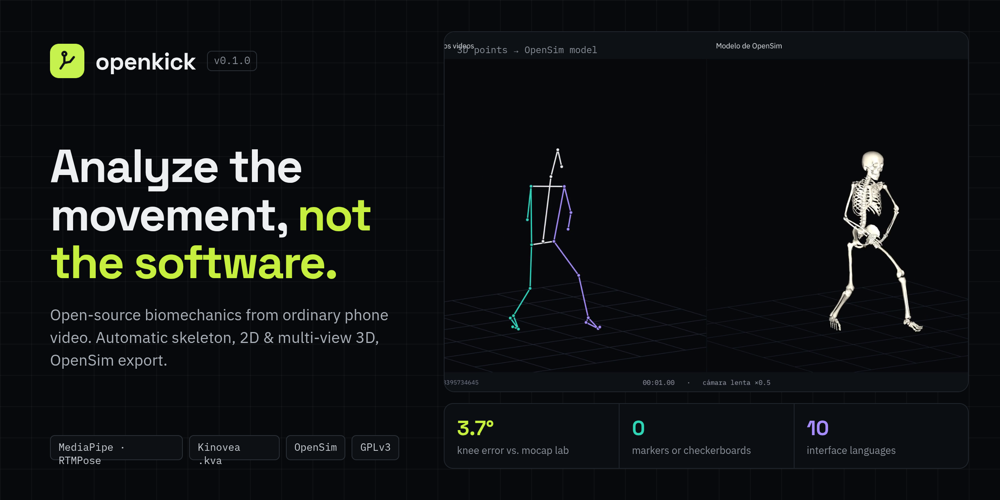
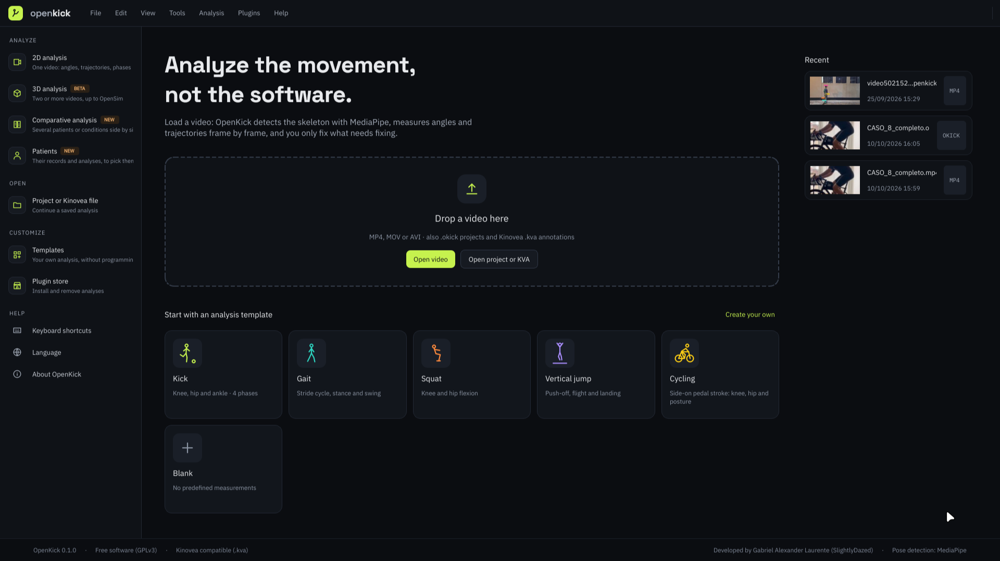
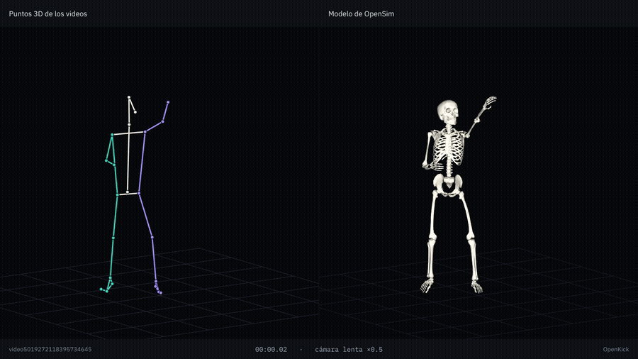
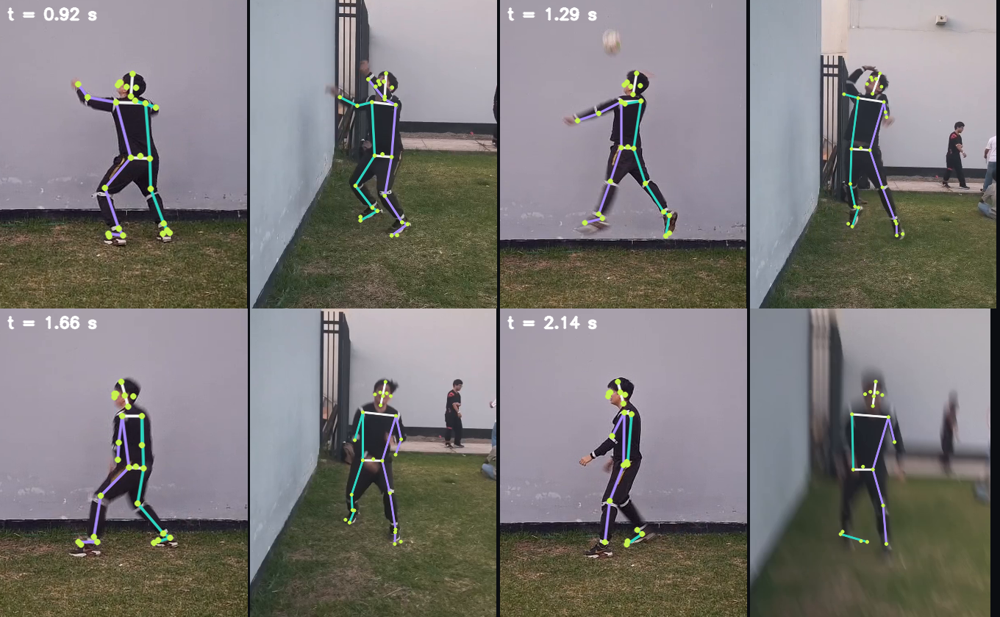
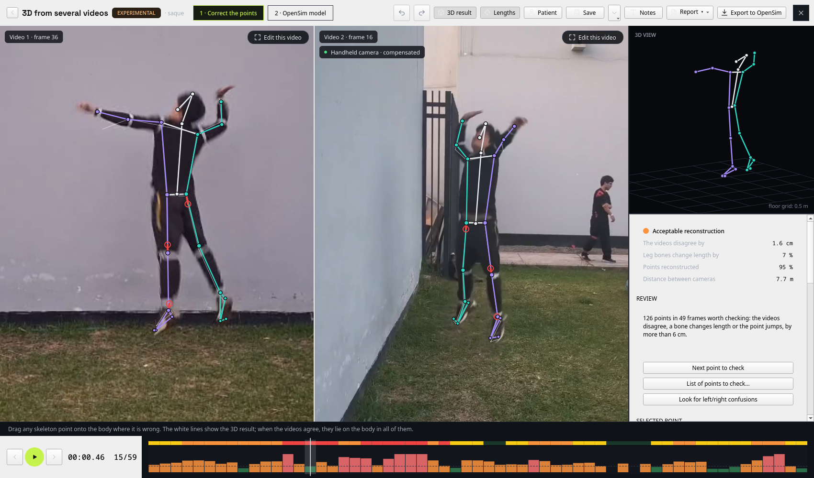
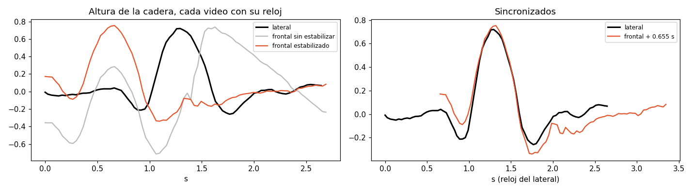
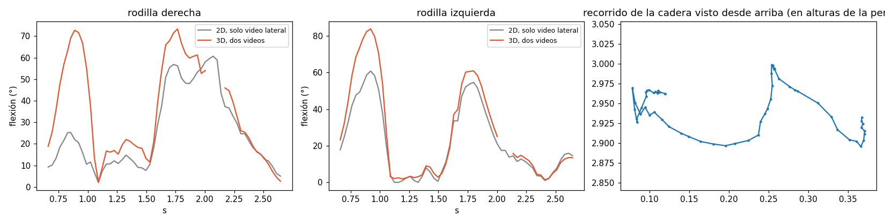

<div align="center">



<br>

**Open-source biomechanics video analysis with automatic pose detection.**<br>
For health and sports professionals who don't code — and compatible with Kinovea.

[](LICENSE)


[**Download**](../../releases) · [Quick start](#quick-start) · [Accuracy](#accuracy) · [Docs](#documentation) · [Roadmap](#roadmap)

</div>

---

<p align="center">
  
</p>

Kinovea is the reference tool for video movement analysis. OpenKick builds on the same idea from a
different starting point: instead of placing and tracking points by hand, a neural network detects the
whole body in every frame, and every measurement is attached to that skeleton.

> **You only fix what the detector got wrong.** Correct a joint once and every angle and trajectory that
> uses it updates on its own. Move work between both programs with Kinovea's `.kva` files.

## Highlights

<table>
<tr>
<td width="50%" valign="top">

### 🦴 Automatic skeleton
MediaPipe, 33 landmarks, in every frame — running in the background while you work.

### 📐 Skeleton-linked measurements
Angles, trajectories with velocity, distances, segment markers, centre of mass (De Leva, 1996) and
free markers with optical-flow tracking.

### ✋ Manual correction that sticks
Drag a joint — this frame, neighbouring frames or a whole phase — with onion-skin ghosts. Corrections
survive re-detection and smoothing.

</td>
<td width="50%" valign="top">

### 🎥 Multi-view 3D <sup>experimental</sup>
2–6 phone videos, synchronized by audio or motion. Cameras are located **from the body itself — no
checkerboard, no markers**.

### 🧬 OpenSim
Scaling and inverse kinematics through Pose2Sim; export `.trc`, `.osim`, `.mot`.

### 🔌 Extensible
Analysis templates without code, Python plugins, patient records, PDF/CSV/JSON reports, 10 languages.

</td>
</tr>
</table>

## From two phone videos to an OpenSim model

<p align="center">
  
</p>

<table>
<tr>
<td width="50%"></td>
<td width="50%"></td>
</tr>
<tr>
<td align="center"><sub><b>One 3D skeleton, both views.</b> Reprojected onto each video at four moments of a serve.</sub></td>
<td align="center"><sub><b>Assisted review.</b> Suspicious points, bone-length guides and a per-frame quality timeline.</sub></td>
</tr>
</table>

<details>
<summary><b>What 3D adds over a single camera</b></summary>
<br>

Automatic synchronization of two hand-held videos — the frontal camera is stabilized, then aligned to the
lateral one by the hip height signal:



Knee flexion seen from one side camera (2D) versus reconstructed from two videos (3D). The side view
underestimates flexion when the leg leaves the camera plane:



</details>

## Accuracy

Measured against a marker-based motion-capture lab using the public
[OpenCap](https://simtk.org/projects/opencap) dataset (Stanford): 9 participants (of its 10; one did not
consent to sharing their videos), 72 recordings, phones on tripods at
60 fps, squats, sit-to-stand, drop jumps and walking. **Automatic output only — no manual correction.**

<div align="center">

| Mean absolute error (°) | 2D · one camera | 3D · two cameras | OpenSim model |
|:---|:---:|:---:|:---:|
| **Knee**     | 5–10  | **4.3** | **3.7** |
| **Hip**      | 7–10  | 7.6     | 9.4 *(flexion)* |
| **Ankle**    | 13–20 | **5.1** | 6.3 |
| **Shoulder** | —     | 5.3     | — |
| **Elbow**    | —     | 14.4 ⚠️ | — |

</div>

<sub>2D: range over the four movements (MediaPipe). 3D: all 72 recordings pooled; the 95 % intervals,
Bland–Altman limits and ICC are in the validation document.</sub>

- ✅ Locating the cameras **from the body matches checkerboard calibration** (within 1°, with 2, 3 and 5 cameras).
- ✅ The knee is the most reliable joint; the ankle needs two cameras.
- ⚠️ **The elbow is not valid yet** (≈14° constant under-flexion); OpenSim hip flexion is overestimated by
  9–16° in squats, sit-to-stand and jumps.
- ⚠️ **3D cycling is not validated against a lab**: so far only a consistency test with one rider at two
  saddle heights.
- ⏳ Not yet measured: gain from manual correction, fast sports movements, hand-held cameras.

Full methods, every table and the commands to reproduce them → [`docs/VALIDATION.md`](docs/VALIDATION.md)

## Installation

**Windows** — download `OpenKick-<version>-Setup.exe` from [**Releases**](../../releases) and run it.
The installer is not code-signed, so SmartScreen may warn: *More info › Run anyway*.

**From source** — Python 3.10–3.12:

```bash
git clone https://github.com/SlightlyDazed/openkick.git
cd openkick
python -m venv .venv
source .venv/bin/activate              # Windows: .venv\Scripts\activate
pip install -e ".[multiview,opensim]"  # or just `pip install -e .` for 2D only
openkick                               # or: python -m openkick [video.mp4 | project.okick | file.kva]
```

The first run downloads the detection models (~30 MB for 2D, ~150 MB for 3D).

## Quick start

| Step | Action | Shortcut |
|:---:|:---|:---:|
| 1 | **Open a video** (or drag it in) — detection starts automatically | — |
| 2 | **Review** — orange marks on the timeline flag doubtful frames | <kbd>Tab</kbd> |
| 3 | **Correct** a joint by dragging it | — |
| 4 | **Measure** — angle, trajectory, or marker outside the skeleton | <kbd>A</kbd> <kbd>T</kbd> <kbd>P</kbd> |
| 5 | **Phases**, **calibrate** with a known length, then **results** and export | <kbd>F</kbd> <kbd>C</kbd> <kbd>Ctrl</kbd>+<kbd>R</kbd> |

Built-in templates — **kick, gait, squat, vertical jump, cycling** — create the angles, trajectories and
phases for you, in 2D and 3D. For 3D: *Analysis › 3D from several videos (experimental)…*

> [!TIP]
> **Recording:** whole body in frame, tripod, no zoom, main lens, 60 fps if possible. 2D needs the camera
> side-on to the movement; 3D needs cameras recording at the same time from different angles.

## Documentation

| Document | Content |
|:---|:---|
| [`OVERVIEW.md`](docs/OVERVIEW.md) | Complete user overview |
| [`MULTIVIEW_3D.md`](docs/MULTIVIEW_3D.md) | Multi-view 3D, correction tools, OpenSim |
| [`VALIDATION.md`](docs/VALIDATION.md) | Accuracy study and how to reproduce it |
| [`TEMPLATES.md`](docs/TEMPLATES.md) | Writing analysis templates (no code) |
| [`PLUGINS.md`](docs/PLUGINS.md) | Writing Python plugins |

## Development

```bash
pip install -e ".[dev,multiview,opensim]"
pytest                                   # sample videos are optional (OPENKICK_SAMPLES)
python -m validation.opencap --engine mediapipe --trials squats1 --plots
```

<details>
<summary>Project layout</summary>

```
openkick/
  core/        video (PyAV), pose detection, project model, analysis — no GUI
  multiview/   multi-view 3D: sync, self-calibration, triangulation, OpenSim export
  formats/     Kinovea .kva, CSV
  plugins/     plugin API and built-in plugins
  ui/          PySide6 (Qt 6) interface
  templates/   built-in analysis templates (JSON)
  locale/      translations (JSON)
validation/    accuracy benchmark against the OpenCap dataset
packaging/     PyInstaller spec and Inno Setup installer
```

</details>

## Roadmap

- [ ] Validate 3D cycling against a reference (skin markers or goniometer)
- [ ] Measure how much manual correction improves accuracy
- [ ] Reliability and usability study with physiotherapists vs. Kinovea and goniometer
- [ ] Sports movements (kicks, serves, throws) with lab access

## License

Copyright © 2026 Gabriel Alexander Laurente ([@SlightlyDazed](https://github.com/SlightlyDazed)).
Released under the [GNU GPL v3 or later](LICENSE).
MediaPipe is Apache 2.0; IBM Plex and Space Grotesk fonts are under the SIL Open Font License.

> [!IMPORTANT]
> OpenKick is a research tool, **not a medical device**.
